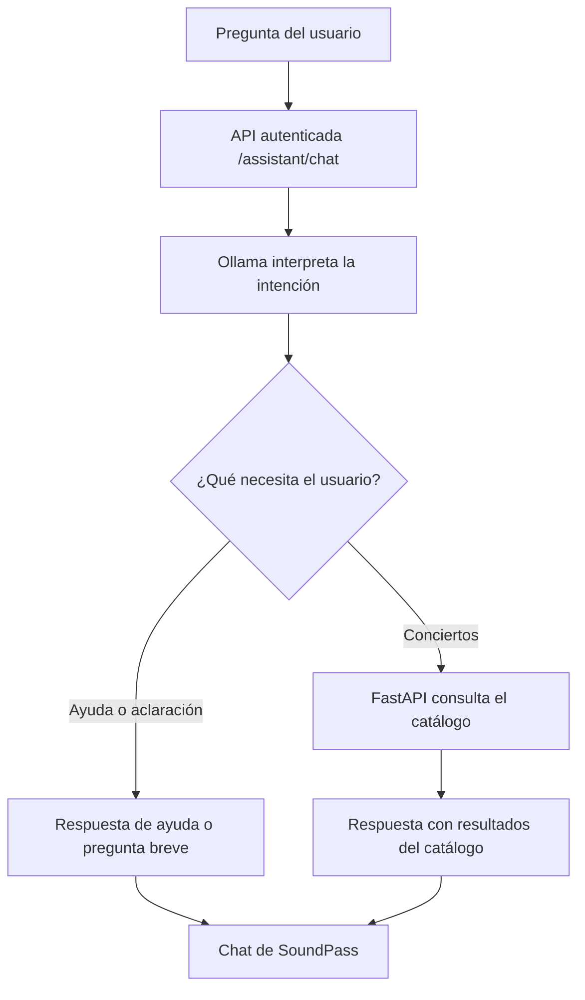
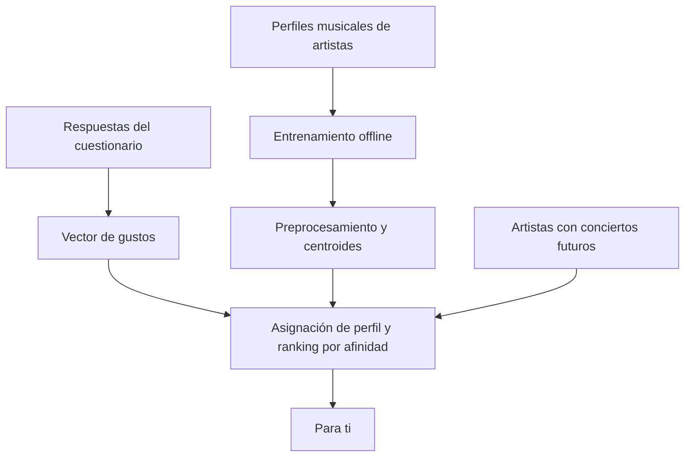
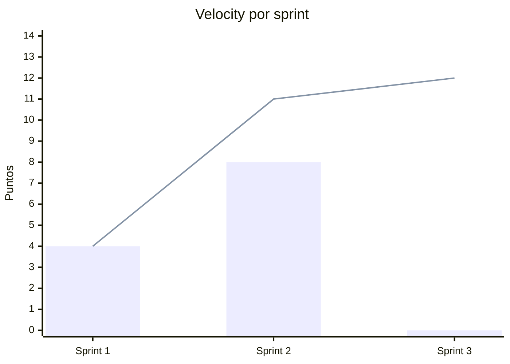
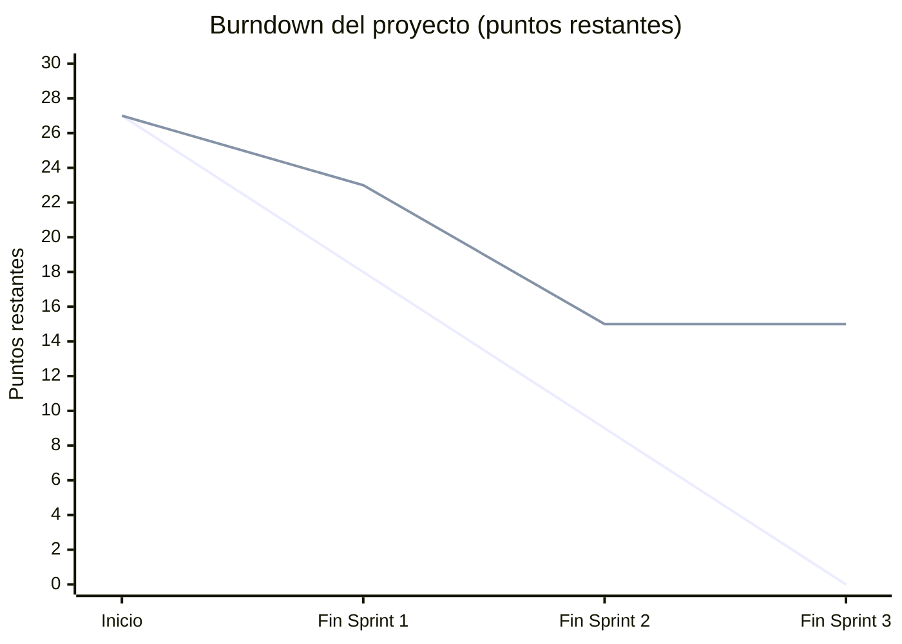

# SoundPass - Gestión Colaborativa

Plataforma web de venta de boletos para conciertos, desarrollada por un equipo de 3 personas con metodología ágil (Kanban en GitHub Projects), integración y despliegue continuos con GitHub Actions y despliegue en la nube de Microsoft Azure.

Actividad de la asignatura **Desarrollo de aplicaciones en la nube**, Fundación Universitaria Los Libertadores.

| | |
|---|---|
| **Aplicación en producción** | http://20.80.47.160 |
| **Tablero del proyecto** | https://github.com/users/ILUMINX89/projects/2 |
| **Repositorio** | https://github.com/ILUMINX89/Sound_pass |
| **Guía de contribución** | [CONTRIBUTING.md](CONTRIBUTING.md) |
| **Bitácora de errores** | [docs/bitacora.md](docs/bitacora.md) |

---

## Tabla de contenido

- [Equipo de Desarrollo](#equipo-de-desarrollo)
- [Descripción del Proyecto](#descripción-del-proyecto)
- [Arquitectura](#arquitectura)
- [Inteligencia artificial y recomendaciones](#inteligencia-artificial-y-recomendaciones)
- [Metodología](#metodología)
- [Sprints Completados](#sprints-completados)
- [Automatización con GitHub Actions](#automatización-con-github-actions)
- [Métricas del Proyecto](#métricas-del-proyecto)
- [Instalación y Uso](#instalación-y-uso)
- [Despliegue en Azure](#despliegue-en-azure)
- [API REST](#api-rest)
- [Lecciones Aprendidas](#lecciones-aprendidas)
- [Estructura del repositorio](#estructura-del-repositorio)
- [Enlaces Importantes](#enlaces-importantes)
- [Perfil público de seguridad](#perfil-público-de-seguridad-issue-68)
- [Kubernetes y monitoreo](#kubernetes-y-monitoreo-proyecto-3)
- [Problemas y soluciones](#problemas-y-soluciones)

---

## Equipo de Desarrollo

| Rol | Integrante | GitHub |
|---|---|---|
| **Product Owner** | Esteban Parra | [@ILUMINX89](https://github.com/ILUMINX89) |
| **Backend Developer** | Esteban Parra | [@ILUMINX89](https://github.com/ILUMINX89) |
| **Frontend Developer / QA** | Sergio Arias | [@Sergioa-aR](https://github.com/Sergioa-aR) |
| **DevOps Engineer** | Camilo Montenegro | [@imaakro](https://github.com/imaakro) |

---

## Descripción del Proyecto

**Dominio:** sistema de eventos y venta de boletos.

SoundPass permite consultar un catálogo de conciertos, filtrarlo por ciudad y género, registrarse como usuario, comprar boletos de distintas categorías y consultar o cancelar las órdenes propias.

El modelo de datos tiene **seis tablas** organizadas en dos cadenas de relación:

- **Catálogo:** un recinto (`venues`) aloja muchos conciertos (`concerts`), y cada concierto ofrece varios tipos de boleta (`ticket_types`) con su precio y disponibilidad.
- **Compra:** un usuario (`users`) genera órdenes (`orders`), y cada orden agrupa sus ítems (`order_items`) con la cantidad comprada.

| Tabla | Descripción | Relaciones |
|---|---|---|
| `users` | Cuentas registradas | 1:N con `orders` |
| `venues` | Recintos: nombre, ciudad, dirección, aforo | 1:N con `concerts` |
| `concerts` | Artista, gira, género, fecha y hora | N:1 con `venues`, 1:N con `ticket_types` |
| `ticket_types` | Categoría de boleta, precio, disponibilidad | N:1 con `concerts` |
| `orders` | Orden de compra con código, estado y total | N:1 con `users`, 1:N con `order_items` |
| `order_items` | Ítems de la orden con cantidad y precio unitario | N:1 con `orders` y `ticket_types` |

---

## Arquitectura

- **Frontend:** HTML, CSS y JavaScript sin framework, servido por nginx
- **Backend:** FastAPI 0.115 + SQLAlchemy 2.0 (Python 3.12), autenticación JWT y contraseñas con bcrypt
- **Base de datos:** PostgreSQL 16
- **Infraestructura:** Microsoft Azure, máquina virtual Ubuntu (el profesor confirmó que se puede usar cualquier nube)
- **CI/CD:** GitHub Actions
- **Containerización:** Docker y Docker Compose

```
                    ┌──────────────────────────────────────────────────────┐
                    │      Azure · Máquina Virtual Ubuntu (soundpass-v2)   │
                    │                    20.80.47.160                      │
   Navegador        │                                                      │
   ──────────►  :80 │  ┌──────────┐    ┌───────────────┐   ┌─────────────┐ │
                    │  │  nginx   │───►│   FastAPI     │──►│ PostgreSQL  │ │
                    │  │          │    │ contenedor    │   │ contenedor  │ │
                    │  │ /  → web │    │    :8000      │   │    :5432    │ │
                    │  │ /api → ↗ │    └───────────────┘   └─────────────┘ │
                    │  └──────────┘        red interna de Docker           │
                    └──────────────────────────────────────────────────────┘
                              ▲
                              │ SSH con llave de despliegue
                    ┌─────────┴──────────┐
                    │   GitHub Actions   │  merge a production → despliegue
                    └────────────────────┘
```

Decisiones de diseño:

1. **Máquina virtual con Docker** para que el entorno local y el de producción sean idénticos: el mismo `docker-compose.yml` corre en ambos.
2. **nginx como proxy inverso.** El frontend y la API salen del mismo origen (`/` y `/api`), así el navegador no cruza orígenes y no hay problemas de CORS.
3. **Ninguna credencial en el código.** Las claves del servidor se generan dentro de la VM en un `docker-compose.override.yml` que no se versiona, y las de GitHub Actions están en *Secrets*.
4. **Superficie mínima expuesta.** En Azure solo están abiertos los puertos 22 (SSH) y 80 (HTTP). La API (8000) y la base de datos (5432) no son accesibles desde internet.

---

## Inteligencia artificial y recomendaciones

SoundPass incorpora dos capacidades diferenciadas: un asistente conversacional apoyado en Ollama para consultar el catálogo en lenguaje natural y un recomendador K-means entrenado offline para ordenar la sección «Para ti» según las preferencias guardadas de cada cuenta.

### Asistente de SoundPass



El asistente separa la comprensión del lenguaje natural de los datos del catálogo:

- **Qué interpreta Ollama:** dada una pregunta como *«Fechas de Bad Bunny en Madrid»* o *«¿Qué conciertos hay próximos de mayor a menor en tiempo?»*, Ollama devuelve un JSON compacto validado con Pydantic (`CatalogIntent`) que solo clasifica `intent` (`concerts`, `help` o `clarify`), `order` (`nearest_first` o `latest_first`) y los filtros opcionales `artist` y `city`.
- **Cómo responde el backend:** cuando la intención es `concerts`, FastAPI consulta directamente los registros reales del catálogo para construir la respuesta con fechas, recintos y ciudades verificables sin inventar eventos ni políticas; si la pregunta es de soporte o ambigua, devuelve una guía breve de ayuda o solicita una aclaración.
- **Estado y configuración verificados:** el chat (`#screen-assistant` en `frontend/index.html` y `frontend/script.js` con `AI_CONTRACT.path = "/assistant/chat"`), el proxy de Nginx (`/api/assistant/chat`), el router autenticado (`backend/src/routers/assistant.py`, registrado en `backend/src/main.py`) y las variables en `docker-compose.yml` y `backend/.env.example` están integrados en `development` consultando el catálogo en vivo de Ticketmaster Discovery. Se configuran `OLLAMA_BASE_URL` (vacía desactiva el asistente devolviendo HTTP 503), `OLLAMA_MODEL=qwen2.5:1.5b` y `OLLAMA_TIMEOUT_SECONDS=55`. La respuesta en vivo requiere conectividad de red desde el contenedor `api` hasta el servidor Ollama configurado.

### Recomendador K-means



- **Flujo de usuario y persistencia:** tras el registro autenticado (y en cualquier momento desde el menú de cuenta o la portada), el usuario puede completar un cuestionario opcional en tres pasos: **Géneros** (hasta 5), **Artistas** (hasta 8) y **Sonido** (cuatro escalas opcionales de 1 a 5: baile, energía, acústica y ánimo). Puede **omitir** en el alta o **editar** después; las respuestas se validan en el backend y se persisten por cuenta en la tabla `user_preferences` de PostgreSQL (`database/migrations/003_user_preferences.sql`), accesibles solo con el token de la propia cuenta (`/api/preferences/options`, `/api/preferences/me`, `/api/preferences/me/skip` y `/api/preferences/me/recommendations`).
- **Perfil y ranking:** las respuestas se combinan en un vector de cuatro señales (pesos `0.4` escalas, `0.4` artistas y `0.2` géneros, renormalizados según las señales presentes). El runtime en Python puro (`backend/src/recommendation/engine.py`) proyecta el vector en el espacio del modelo, asigna el perfil musical con K-means y ordena por distancia euclidiana a los artistas con eventos futuros elegibles del catálogo real (una tarjeta por artista con la fecha válida más cercana y desempates deterministas). Si falta el vector de un artista se usa el prototipo de género curado con penalización; si el usuario omite el formulario, el modelo no está disponible o no hay coincidencias, la portada conserva el catálogo general. El recomendador ordena por afinidad musical y no predice compras.
- **Entrenamiento offline y métricas reales:** el entrenamiento nunca se ejecuta al registrar usuarios. `backend/training/train.py` procesa `backend/training/artist_profiles.json` (131 artistas con IDs estables `art_*`: 127 con vector de cuatro señales y 4 sin vector para respaldo por género; borrador editorial propio del proyecto **pendiente de revisión humana**, fuera de Spotify y sin datos de terceros). Separa entrenamiento y evaluación por artista (99 / 28, estratificado por género principal), compara escalado 4-D frente a escalado + PCA(2) para `k=2..8` y 10 semillas, y publica artefactos versionados y verificados por SHA-256 en `backend/src/recommendation/artifacts/`.
  - **Modelo seleccionado (`kmeans-scaled_pca2-k3-3e3d04df`, `scaled_pca2`, `k=3`):** silueta de entrenamiento `0.430`, silueta de evaluación `0.462`, estabilidad ARI entre semillas `1.000`, estabilidad ARI en submuestras `0.986`, cobertura del catálogo vivo `100 %` (8/8 artistas con vector propio) y precisión@5 media de `0.60` sobre 5 perfiles de gusto de prueba (frente a `0.229` aleatorio y `0.80` solo por género).
  - El método adapta ideas de `soundpass-recomendador-kmeans` (aviso MIT en `backend/training/NOTICE-MIT.md`), pero utiliza un conjunto de perfiles y una partición distintos; estas métricas corresponden únicamente al modelo local y no se comparan como mejora frente al repositorio de referencia.

---

## Metodología

Trabajamos con **Kanban** en GitHub Projects, simulando **3 sprints**:

| Sprint | Fechas | Enfoque |
|---|---|---|
| Sprint 1 | 13 al 15 de octubre | Configuración del proyecto, seguridad y backend |
| Sprint 2 | 16 al 18 de octubre | Frontend, integración continua y automatización |
| Sprint 3 | 19 al 22 de octubre | Despliegue, documentación y mejoras pedidas por el profesor |

**Tablero:** `Backlog → Ready → In Progress → Review → Done`

**Campos personalizados:** Sprint (1, 2, 3), Prioridad (Alta, Media, Baja), Estimación (1, 2, 3, 5, 8), Tipo (Feature, Bug, Documentation, DevOps) y Rol (Backend, Frontend, DevOps, QA, Documentación). El responsable es la persona asignada al issue.

**Ramas:**

```
main                      versión estable (rama por defecto)
├── production            lo que está desplegado; cada merge despliega la app
└── development           integración del sprint
     ├── feature/sprintN-<funcionalidad>
     └── fix/<error>
```

**Flujo de trabajo:** issue con la plantilla → rama `feature/` desde `development` → commits con formato `tipo: descripción` → PR hacia `development` con `Closes #N` → revisión de otro miembro → merge → release a `production` (despliegue automático) → `main`.

El paso a paso completo para cualquier miembro está en [CONTRIBUTING.md](CONTRIBUTING.md).

---

## Sprints Completados

Estado al 22 de octubre de 2026. Las historias "en revisión" tienen su PR abierto esperando aprobación.

### Sprint 1: configuración y seguridad

| Historia | Responsable | Puntos | Estado | Evidencia |
|---|---|---|---|---|
| [#3 Proteger credenciales del repositorio](https://github.com/ILUMINX89/Sound_pass/issues/3) | @imaakro | 2 | ✅ Done | [PR #1](https://github.com/ILUMINX89/Sound_pass/pull/1) |
| [#5 Estrategia de ramas y plantilla de historias](https://github.com/ILUMINX89/Sound_pass/issues/5) | @imaakro | 2 | ✅ Done | Ramas `main`, `development`, `production` |
<!-- @ILUMINX89 y @Sergioa-aR: agregar aquí sus historias del Sprint 1 -->

### Sprint 2: frontend, CI y automatización

| Historia | Responsable | Puntos | Estado | Evidencia |
|---|---|---|---|---|
| [#4 Integración continua con GitHub Actions](https://github.com/ILUMINX89/Sound_pass/issues/4) | @imaakro | 3 | ✅ Done | [PR #2](https://github.com/ILUMINX89/Sound_pass/pull/2) |
| [#6 Workflow de automatización del tablero](https://github.com/ILUMINX89/Sound_pass/issues/6) | @imaakro | 5 | ✅ Done | [PR #7](https://github.com/ILUMINX89/Sound_pass/pull/7) |
| [#8 Mejoras de la interfaz](https://github.com/ILUMINX89/Sound_pass/issues/8) | @Sergioa-aR | 1 | 🔍 En revisión | [PR #20](https://github.com/ILUMINX89/Sound_pass/pull/20) |
| [#9 Adaptación responsive](https://github.com/ILUMINX89/Sound_pass/issues/9) | @Sergioa-aR | 1 | 🔍 En revisión | [PR #23](https://github.com/ILUMINX89/Sound_pass/pull/23) |
| [#10 Vista de detalle de orden](https://github.com/ILUMINX89/Sound_pass/issues/10) | @Sergioa-aR | 1 | 🚧 En progreso | |
<!-- @ILUMINX89: agregar aquí sus historias del Sprint 2 -->

### Sprint 3: despliegue, documentación y mejoras

| Historia | Responsable | Puntos | Estado | Evidencia |
|---|---|---|---|---|
| [#11 Plantillas de issues detalladas](https://github.com/ILUMINX89/Sound_pass/issues/11) | @imaakro | 3 | 🔍 En revisión | [PR #12](https://github.com/ILUMINX89/Sound_pass/pull/12) |
| [#13 Rol y campos automáticos en el tablero](https://github.com/ILUMINX89/Sound_pass/issues/13) | @imaakro | 3 | 🔍 En revisión | [PR #14](https://github.com/ILUMINX89/Sound_pass/pull/14) |
| [#15 Revisión automática del formato de commits](https://github.com/ILUMINX89/Sound_pass/issues/15) | @imaakro | 2 | 🔍 En revisión | [PR #16](https://github.com/ILUMINX89/Sound_pass/pull/16) |
| [#17 Guía de contribución y bitácora de errores](https://github.com/ILUMINX89/Sound_pass/issues/17) | @imaakro | 3 | 🔍 En revisión | [PR #18](https://github.com/ILUMINX89/Sound_pass/pull/18) |
| [#21 Bug: no aparecen conciertos porque sus fechas ya pasaron](https://github.com/ILUMINX89/Sound_pass/issues/21) | @imaakro | 1 | 🔍 En revisión | [PR #22](https://github.com/ILUMINX89/Sound_pass/pull/22) |
<!-- @imaakro: agregar la historia de despliegue continuo cuando tenga su issue y PR -->
<!-- @ILUMINX89 y @Sergioa-aR: agregar aquí sus historias del Sprint 3 -->

---

## Automatización con GitHub Actions

| Workflow | Archivo | Cuándo corre | Qué hace |
|---|---|---|---|
| **CI** | `.github/workflows/ci.yml` | En cada PR | Instala dependencias y comprueba que el backend funcione |
| **Project Automation** | `.github/workflows/project-automation.yml` | Al crear, editar o asignar un issue y al abrir o mergear un PR | Llena Rol, Tipo, Prioridad, Sprint y Estimación desde la plantilla, pone etiquetas para filtrar y mueve la tarjeta: asignado → **In Progress**, PR abierto → **Review**, PR mergeado → **Done** |
| **Revisión de commits** | `.github/workflows/commits.yml` | En cada PR | Falla si algún commit no sigue el formato `tipo: descripción` |
| **Despliegue (CD)** | `.github/workflows/deploy.yml` | Al hacer merge a `production` (o a mano) | Copia el código a la VM por SSH, reconstruye los contenedores y verifica que `/api/health` responda |

**Plantillas de issue** (`.github/ISSUE_TEMPLATE/`): historia de usuario, bug y feedback de usuario externo, con campos obligatorios para que cualquier persona entienda qué hacer sin preguntar.

**Secretos usados:** `PROJECT_TOKEN` (editar el tablero), `VM_HOST`, `VM_USER`, `VM_SSH_KEY`, `VM_APP_DIR` (despliegue).

---

## Métricas del Proyecto

Datos tomados del tablero y de los PRs del repositorio el **22 de octubre de 2026**. Una historia cuenta como completada cuando su PR se mergea a `development`.

### Resumen

| Métrica | Valor |
|---|---|
| **Velocity promedio** | 6 puntos por sprint (sprints 1 y 2) |
| **Historias completadas** | 4 de 12 (27 puntos planeados; 8 historias en revisión o en progreso) |
| **Bugs encontrados** | 1 registrado como issue (#21) y 11 incidentes documentados en la [bitácora](docs/bitacora.md) |
| **Tiempo promedio de resolución (lead time)** | 19,8 horas |
| **Cycle time promedio** | 20,4 horas |
| **Throughput** | 2 historias por sprint en los sprints 1 y 2 |

### Velocity: puntos completados por sprint

| Sprint | Puntos planeados | Puntos completados |
|---|---|---|
| Sprint 1 | 4 | 4 |
| Sprint 2 | 11 | 8 |
| Sprint 3 | 12 | 0 (12 en revisión) |



*Barras: puntos completados. Línea: puntos planeados.*

### Burndown: trabajo restante vs tiempo



*Primera línea: ritmo ideal. Segunda línea: trabajo restante real.*

### Lead time y cycle time

- **Lead time:** desde que se crea la historia hasta que su PR se mergea.
- **Cycle time:** desde el primer commit de la historia (cuando empieza el trabajo) hasta el merge.

| Historia | PR | Lead time | Cycle time | Esperando revisión |
|---|---|---|---|---|
| #3 Proteger credenciales | #1 | 19,9 h | 21,0 h | 20,2 h |
| #4 Integración continua | #2 | 19,9 h | 20,6 h | 20,2 h |
| #6 Automatización del tablero | #7 | 19,6 h | 19,5 h | 19,4 h |
| **Promedio** | | **19,8 h** | **20,4 h** | **19,9 h** |

La historia #5 no se incluye porque su issue se creó después de terminar el trabajo.

**Lectura:** casi todo el cycle time es espera de revisión (19,9 de 20,4 horas). El desarrollo es rápido; el cuello de botella es la revisión de PRs.

### Throughput: historias completadas por periodo

| Periodo | Historias completadas |
|---|---|
| Sprint 1 | 2 |
| Sprint 2 | 2 |
| Sprint 3 | 0 (5 en revisión) |

### Participación

| Integrante | Historias creadas | PRs abiertos |
|---|---|---|
| @imaakro | 9 | 8 |
| @Sergioa-aR | 3 | 3 |
| @ILUMINX89 | 0 | 0 |

<!-- Actualizar estas cifras después de mergear los PRs pendientes y de que todos registren sus historias -->

---

## Instalación y Uso

**Requisitos:** Git, Docker Desktop y VS Code.

```bash
git clone https://github.com/ILUMINX89/Sound_pass.git
cd Sound_pass
docker compose up -d --build
```

Docker ejecuta `database/schema.sql` y `database/seed.sql` la primera vez que arranca PostgreSQL, así que la base queda poblada sin pasos adicionales.

| Qué | Dónde |
|---|---|
| API | http://127.0.0.1:8000 |
| Documentación interactiva (Swagger) | http://127.0.0.1:8000/docs |
| Frontend | abrir `frontend/index.html` con Live Server |

Para empezar desde cero: `docker compose down -v` y otra vez `docker compose up -d --build`.

### Variables de entorno

Copiar `backend/.env.example` a `backend/.env` y ajustar:

| Variable | Descripción |
|---|---|
| `DATABASE_URL` | Cadena de conexión SQLAlchemy a PostgreSQL |
| `SECRET_KEY` | Clave de firma de los tokens JWT |
| `ACCESS_TOKEN_EXPIRE_MINUTES` | Vigencia del token (por defecto 1440) |
| `ALLOWED_ORIGINS` | Orígenes permitidos por CORS, separados por coma |

### Credenciales de prueba

Se puede registrar una cuenta nueva desde la aplicación, o usar los usuarios de `seed.sql`:

| Correo | Contraseña |
|---|---|
| camila.torres@example.com | demo123 |
| andres.gomez@example.com | demo123 |

Las contraseñas se guardan con hash bcrypt.

---

## Despliegue en Azure

### Despliegue automático (CD)

Al hacer merge de `development` a `production`, el workflow **Despliegue (CD)**:

1. Copia `backend`, `frontend`, `database` y `docker-compose.yml` a la VM por SSH.
2. Ejecuta `docker compose up -d --build` y copia el frontend a `/var/www/soundpass/`.
3. Verifica que `http://20.80.47.160/api/health` responda; si no, el workflow sale en rojo.

También se puede lanzar a mano en **Actions → Despliegue (CD) → Run workflow**.

### Preparación de la máquina virtual (una sola vez)

1. VM Ubuntu en Azure con reglas de entrada para los puertos **22** (SSH) y **80** (HTTP).
2. Instalar nginx y Docker, y agregar el usuario al grupo `docker` para no necesitar `sudo`:
   ```bash
   sudo apt-get update && sudo apt-get install -y nginx
   curl -fsSL https://get.docker.com | sudo sh
   sudo usermod -aG docker soundpass
   ```
3. Agregar la llave pública de despliegue en `~/.ssh/authorized_keys` y guardar la privada como secreto `VM_SSH_KEY` en GitHub.
4. Crear las credenciales del servidor con claves aleatorias, sin que nadie las vea:
   ```bash
   cd ~/Sound_pass
   DBPASS=$(openssl rand -hex 16)
   JWT=$(openssl rand -hex 32)
   cat > docker-compose.override.yml <<EOF
   services:
     db:
       restart: unless-stopped
       environment:
         POSTGRES_PASSWORD: $DBPASS
     api:
       restart: unless-stopped
       environment:
         DATABASE_URL: postgresql+psycopg2://soundpass_user:$DBPASS@db:5432/soundpass
         SECRET_KEY: $JWT
         ALLOWED_ORIGINS: http://20.80.47.160
   EOF
   ```
5. Configurar nginx en `/etc/nginx/sites-available/soundpass`:
   ```nginx
   server {
       listen 80;
       server_name _;
       root /var/www/soundpass;
       index index.html;

       location / {
           try_files $uri $uri/ /index.html;
       }

       location /api/ {
           proxy_pass http://127.0.0.1:8000/;
           proxy_set_header Host $host;
           proxy_set_header X-Forwarded-For $proxy_add_x_forwarded_for;
       }
   }
   ```

Los contenedores usan `restart: unless-stopped` y nginx corre como servicio del sistema, así que la app vuelve sola si la VM se reinicia.

---

## API REST

Documentación interactiva: `/docs` (Swagger UI). En producción todas las rutas van con el prefijo `/api` (por ejemplo `http://20.80.47.160/api/concerts`).

### Autenticación

| Método | Ruta | Descripción |
|---|---|---|
| POST | `/auth/register` | Crea una cuenta. Devuelve 201 |
| POST | `/auth/login` | Devuelve el token JWT |
| GET | `/auth/me` | Datos del usuario autenticado |

### Conciertos

| Método | Ruta | Descripción |
|---|---|---|
| GET | `/concerts` | Lista conciertos futuros. Filtros: `city`, `genre`, `sort` (`date`, `price_asc`, `price_desc`) |
| GET | `/concerts/{id}` | Detalle con recinto y tipos de boleta |
| POST | `/concerts` | Crea un concierto. Devuelve 201 |
| PUT | `/concerts/{id}` | Actualiza un concierto |
| DELETE | `/concerts/{id}` | Elimina un concierto. Devuelve 204 |
| GET | `/concerts/{id}/ticket_types` | Tipos de boleta del concierto |

### Recintos

| Método | Ruta | Descripción |
|---|---|---|
| GET | `/venues` | Lista todos los recintos |
| POST | `/venues` | Crea un recinto. Devuelve 201 |
| DELETE | `/venues/{id}` | Elimina un recinto. Devuelve 204 |

### Órdenes (requieren token)

| Método | Ruta | Descripción |
|---|---|---|
| POST | `/orders` | Crea una orden con sus ítems. Devuelve 201 |
| GET | `/orders/me` | Órdenes del usuario autenticado |
| GET | `/orders/{id}` | Detalle de una orden propia |
| POST | `/orders/{id}/cancel` | Cancela una orden |

### Utilidad

| Método | Ruta | Descripción |
|---|---|---|
| GET | `/health` | Verificación de estado del servicio |

### Ejemplo de uso

```bash
# Registro
curl -X POST http://20.80.47.160/api/auth/register \
  -H "Content-Type: application/json" \
  -d '{"full_name":"Ana Gómez","email":"ana@ejemplo.com","password":"clave123"}'

# Ingreso
curl -X POST http://20.80.47.160/api/auth/login \
  -H "Content-Type: application/json" \
  -d '{"email":"ana@ejemplo.com","password":"clave123"}'
```

| Código | Significado |
|---|---|
| 200 / 201 / 204 | Operación exitosa |
| 400 | Tipo de boleta inválido para ese concierto |
| 401 | Falta el token o es inválido |
| 404 | El recurso no existe |
| 409 | No hay disponibilidad suficiente |
| 422 | El cuerpo de la petición no pasó la validación |

---

## Lecciones Aprendidas

El detalle de cada problema, con causa, solución, pros y contras, está en la [bitácora](docs/bitacora.md). Lo más importante:

**Lo que funcionó bien**
- **Automatizar el tablero.** Las tarjetas se mueven solas y los campos se llenan desde la plantilla, así el tablero refleja el estado real sin esfuerzo manual.
- **Plantillas y guía de contribución.** Con issues detallados y un `CONTRIBUTING.md` paso a paso, cualquier miembro puede tomar una tarea sin preguntarle a los demás.
- **Docker en local y en producción.** El mismo `docker-compose.yml` evitó diferencias entre la máquina de cada uno y la nube.

**Lo que salió mal y qué cambiamos**
- **Credenciales reales en el repositorio.** Se reemplazaron por valores de ejemplo; ahora los valores reales solo van en *Secrets* o en archivos que Git ignora.
- **Merges sin revisión.** Se acordó que nadie mergea su propio PR y se documentó en la guía.
- **`Closes #N` no funciona hacia `development`.** GitHub solo lo reconoce en PRs hacia la rama por defecto; la automatización ahora lee el número de la descripción del PR.
- **Permisos de GitHub Actions.** El token por defecto no podía leer los commits del PR; cada workflow ahora declara los permisos que necesita.
- **El despliegue dependía de una sola persona.** Se montó una VM nueva con una llave solo para despliegues, de modo que GitHub Actions despliega sin intervención humana.
- **Datos de ejemplo con fechas fijas.** Los conciertos de 2025 dejaron de mostrarse en 2026; las fechas de ejemplo deberían ser relativas a la fecha actual.

**Mejoras futuras**
- Proteger `development` y `production` con reglas que exijan 1 aprobación antes del merge.
- Revisar los PRs el mismo día: las métricas muestran que la espera de revisión es casi todo el cycle time.
- HTTPS con un dominio propio y Let's Encrypt.
- Pruebas automatizadas del backend dentro del CI.
- Usar IA en la automatización (por ejemplo, revisión automática de PRs o clasificación de issues) en la entrega final.

---

## Estructura del repositorio

```
Sound_pass/
├── README.md
├── CONTRIBUTING.md                 # Cómo trabajar en el proyecto paso a paso
├── docker-compose.yml
├── .github/
│   ├── ISSUE_TEMPLATE/             # Plantillas: historia, bug y feedback externo
│   └── workflows/
│       ├── ci.yml
│       ├── project-automation.yml
│       ├── commits.yml
│       └── deploy.yml
├── backend/
│   ├── Dockerfile
│   ├── requirements.txt
│   ├── .env.example
│   └── src/
│       ├── main.py
│       ├── config.py
│       ├── database.py
│       ├── models.py
│       ├── schemas.py
│       ├── security.py
│       └── routers/
│           ├── auth.py
│           ├── concerts.py
│           ├── venues.py
│           └── orders.py
├── frontend/
│   ├── index.html
│   ├── style.css
│   └── script.js
├── database/
│   ├── schema.sql
│   └── seed.sql
└── docs/
    ├── bitacora.md                 # Errores, causas, soluciones, pros y contras
    └── feedback-externo.md         # Pruebas con usuarios fuera del equipo
```

---

## Enlaces Importantes

- [Aplicación](http://20.80.47.160)
- [GitHub Project](https://github.com/users/ILUMINX89/projects/2)
- [Repositorio](https://github.com/ILUMINX89/Sound_pass)
- [GitHub Actions](https://github.com/ILUMINX89/Sound_pass/actions)
- [Pull requests](https://github.com/ILUMINX89/Sound_pass/pulls?q=is%3Apr)
- [Guía de contribución](CONTRIBUTING.md)
- [Bitácora de errores](docs/bitacora.md)

## Perfil público de seguridad (issue #68)

La configuración preparada para el perfil público, ejemplos de entorno y pasos
pendientes con DevOps se describen en [docs/seguridad-api.md](docs/seguridad-api.md).
Esa guía reemplaza las instrucciones anteriores de puertos públicos y configuración
JWT de ejemplo: HTTPS y la topología real de la VM todavía deben verificarse.

## Kubernetes y monitoreo (Proyecto 3)

La aplicación corre en un clúster local de **Minikube**. La API tiene 2 réplicas (hasta 5 con autoescalado), PostgreSQL corre dentro del clúster con un disco persistente, y Prometheus y Grafana miden la API.

### Arquitectura

```
Navegador ──> Ingress (soundpass.local) ──┬──> frontend (nginx)        namespace: soundpass
                                          └──> /api ──> Service soundpass-api ──> 2 a 5 pods de la API
                                                                                    │
                                                         Service soundpass-db <─────┘
                                                         PostgreSQL (StatefulSet + disco 1Gi)

Prometheus ── lee /metrics de cada pod de la API cada 15 s ──> Grafana (dashboard SoundPass)
                                                                    namespace: monitoring
```

| Archivo | Qué crea |
|---|---|
| `k8s/00-namespace.yaml` | Namespace `soundpass` |
| `k8s/01-configmap.yaml` | Configuración no sensible (`ALLOWED_ORIGINS`, usuario y nombre de la base) |
| `k8s/secret.example.yaml` | Plantilla del Secret (`DATABASE_URL`, `SECRET_KEY`, claves de Spotify y Ticketmaster). El real, `secret.yaml`, no se sube |
| `k8s/10-postgres.yaml` | PostgreSQL: StatefulSet, disco de 1Gi y Service `soundpass-db` |
| `k8s/20-api.yaml` | API: Deployment con 2 réplicas, probes en `/health`, requests/limits y Service |
| `k8s/30-frontend.yaml` | Frontend (nginx) y su Service |
| `k8s/40-ingress.yaml` | Ingress: `/` al frontend y `/api` a la API |
| `k8s/50-hpa.yaml` | Autoescalado de 2 a 5 réplicas cuando la CPU pasa del 50 % |
| `k8s/monitoring/` | Valores de Helm, ServiceMonitor y dashboard de Grafana |
| `scripts/trafico.py` | Script para generar tráfico de prueba |
| `k8s/catalog-sync-job.yaml` y `scripts/sync-catalog-minikube.ps1` | Importación inicial de artistas y conciertos de Ticketmaster |

### Requisitos

- Docker Desktop
- [Minikube](https://minikube.sigs.k8s.io/), `kubectl` y [Helm](https://helm.sh/)
- 8 GB de RAM libres para el clúster

### Imágenes

El workflow **Imágenes (GHCR)** (`.github/workflows/images.yml`) construye y publica en cada push a `development`, `production` y `feature/**`:

- `ghcr.io/iluminx89/sound_pass-api`
- `ghcr.io/iluminx89/sound_pass-frontend`

Para desarrollo local se pueden construir directamente dentro de Minikube:

```powershell
minikube image build -t ghcr.io/iluminx89/sound_pass-api:latest backend
minikube image build -t ghcr.io/iluminx89/sound_pass-frontend:latest frontend
```

Para descargarlas de GHCR (repo privado) se crea una credencial con un token que tenga `read:packages`:

```powershell
kubectl create secret docker-registry ghcr-cred -n soundpass --docker-server=ghcr.io --docker-username=<usuario> --docker-password=<token>
```

### Desplegar la aplicación

Ejecuta los comandos desde la raíz de `Sound_pass`, con Docker Desktop abierto. Para una instalación nueva, primero prepara el clúster y el archivo de claves:

```powershell
minikube start --driver=docker --cpus=4 --memory=8192
minikube addons enable ingress
minikube addons enable metrics-server

if (-not (Test-Path 'k8s/secret.yaml')) {
    Copy-Item k8s/secret.example.yaml k8s/secret.yaml
}
```

Completa `k8s/secret.yaml` antes de desplegar. Usa la misma contraseña nueva en `POSTGRES_PASSWORD` y `DATABASE_URL`, una clave aleatoria para `SECRET_KEY` y la clave de Ticketmaster para cargar el catálogo. Si Ollama corre en otro servidor, agrega bajo `stringData` su URL HTTP base en `OLLAMA_BASE_URL` y el modelo disponible en `OLLAMA_MODEL`. El `localhost` de un pod apunta a ese mismo pod. Mantén el Secret fuera de Git.

Construye las dos imágenes como se indica en **Imágenes** y despliega:

```powershell
kubectl --context=minikube create namespace soundpass
kubectl --context=minikube -n soundpass create configmap db-init --from-file=1-schema.sql=database/schema.sql --from-file=2-seed.sql=database/seed.sql
kubectl --context=minikube apply -k k8s/
kubectl --context=minikube -n soundpass get pods,svc
```

Abrir la aplicación:

```powershell
kubectl --context=minikube -n soundpass port-forward svc/soundpass-frontend 8080:80
```

→ http://localhost:8080

Con Ingress: dejar corriendo `minikube tunnel`, agregar `127.0.0.1 soundpass.local` a `C:\Windows\System32\drivers\etc\hosts` y abrir http://soundpass.local

### Inicializar el catálogo de Ticketmaster en Minikube

Con PostgreSQL listo y `TICKETMASTER_API_KEY` configurada en `k8s/secret.yaml`, ejecuta desde PowerShell:

```powershell
.\scripts\sync-catalog-minikube.ps1
```

El script construye la imagen del importador desde el commit `5415c95`, aplica la migración y ejecuta una sincronización por origen del artista. Comprueba `cycle=success` y `published` en los logs. Con el port-forward del frontend abierto, consulta `/api/concerts/ticketmaster?q=` y comprueba que devuelve eventos. Ejecuta este paso al inicializar un volumen nuevo de PostgreSQL.

### Actualizar desde development

Después de que el PR se fusione, actualiza tu copia y despliega la nueva imagen de la API. Si el cambio incluye frontend, también debes reconstruir y desplegar su imagen.

```powershell
git switch development
git pull --ff-only
$commit = git rev-parse --short HEAD
$imagen = "ghcr.io/iluminx89/sound_pass-api:dev-$commit"
minikube image build -t $imagen backend
if ($LASTEXITCODE -ne 0) { throw 'Fallo la compilacion de la API.' }
kubectl --context=minikube -n soundpass set image deploy/soundpass-api "api=$imagen"
if ($LASTEXITCODE -ne 0) { throw 'Fallo la actualizacion de la API.' }
kubectl --context=minikube -n soundpass rollout status deploy/soundpass-api --timeout=180s
```

Si también cambió el frontend, actualiza su imagen con el mismo commit:

```powershell
$frontend = "ghcr.io/iluminx89/sound_pass-frontend:dev-$commit"
minikube image build -t $frontend frontend
if ($LASTEXITCODE -ne 0) { throw 'Fallo la compilacion del frontend.' }
kubectl --context=minikube -n soundpass set image deploy/soundpass-frontend "frontend=$frontend"
kubectl --context=minikube -n soundpass rollout status deploy/soundpass-frontend --timeout=180s
```

Si actualizas un volumen que existía antes de incorporar las preferencias, aplica su migración y comprueba que termina con `COMMIT`:

```powershell
Get-Content .\database\migrations\003_user_preferences.sql -Raw |
    kubectl --context=minikube -n soundpass exec -i soundpass-db-0 -- psql -U soundpass_user -d soundpass -v ON_ERROR_STOP=1
```

Con el acceso de SoundPass abierto, verifica que las preferencias devuelven `True` y que hay eventos. Prueba también guardar preferencias en la página con una sesión iniciada.

```powershell
(Invoke-RestMethod 'http://localhost:8080/api/preferences/options').available
(Invoke-RestMethod 'http://localhost:8080/api/concerts/ticketmaster?q=').events.Count
```

### Monitoreo con Prometheus y Grafana

La API expone `/metrics` con `prometheus-fastapi-instrumentator`:

| Métrica | Tipo | Qué mide |
|---|---|---|
| `http_requests_total` | Contador | Requests por ruta, método y código de respuesta |
| `http_request_duration_seconds` | Histograma | Latencia de cada request |
| `http_requests_inprogress` | Gauge | Requests que se están atendiendo en este momento |

Instalar Prometheus y Grafana dentro del clúster:

```powershell
helm repo add prometheus-community https://prometheus-community.github.io/helm-charts
helm repo update
kubectl --context=minikube create namespace monitoring
$grafanaPassword = [guid]::NewGuid().ToString('N')
kubectl --context=minikube -n monitoring create secret generic grafana-admin --from-literal=admin-user=admin "--from-literal=admin-password=$grafanaPassword"
helm --kube-context minikube upgrade --install monitoring prometheus-community/kube-prometheus-stack -n monitoring -f k8s/monitoring/helm/values.yaml --wait --timeout 10m
kubectl --context=minikube apply -f k8s/monitoring/
kubectl --context=minikube -n monitoring port-forward --address 127.0.0.1 svc/monitoring-grafana 3001:80
```

Abre [Grafana](http://127.0.0.1:3001), inicia sesión como `admin` y entra en **Dashboards → SoundPass**. Si el Secret `grafana-admin` ya existía, se conserva su contraseña anterior. Para recuperarla en PowerShell, lee el valor del Secret y decodifícalo localmente:

```powershell
$encoded = kubectl --context=minikube -n monitoring get secret grafana-admin -o 'jsonpath={.data.admin-password}'
[Text.Encoding]::UTF8.GetString([Convert]::FromBase64String($encoded))
```

Paneles: throughput por ruta, latencia p50/p95, errores 4xx/5xx, CPU por pod, requests en curso, réplicas disponibles y requests totales.

### Tráfico de prueba y autoescalado

```powershell
$script = Get-Content .\scripts\trafico.py -Raw -ErrorAction Stop
$script | kubectl --context=minikube -n soundpass run trafico -i --rm --restart=Never --image=python:3.12-alpine -- python - http://soundpass-api:8000 120 20
```

En otra terminal:

```powershell
kubectl get hpa -n soundpass -w
```

En Grafana, selecciona **Last 5 minutes** y observa el panel de solicitudes por segundo. La subida confirma que Prometheus registra el tráfico. Si la CPU supera el objetivo durante suficiente tiempo, el HPA puede aumentar las réplicas. Comprueba el valor observado antes de afirmar que hubo autoescalado.

### Comandos útiles

| Para | Comando |
|---|---|
| Ver todo | `kubectl get pods,svc,hpa -n soundpass` |
| Logs de la API | `kubectl logs deploy/soundpass-api -n soundpass --tail 50` |
| Por qué no arranca un pod | `kubectl describe pod <nombre> -n soundpass` |
| Probar que se recupera solo | `kubectl delete pod <nombre-de-un-pod-api> -n soundpass` |
| Aplicar cambios del Secret | `kubectl apply -k k8s/` y `kubectl rollout restart deploy/soundpass-api -n soundpass` |
| Apagar el clúster sin borrar nada | `minikube stop` |

### Volver a abrir el entorno y probar la recuperación

Después de apagar el equipo, abre Docker Desktop y ejecuta `minikube start`. Revisa los pods en los namespaces `soundpass` y `monitoring`. Abre los dos comandos de `port-forward` en terminales distintas y déjalas abiertas. El clúster y sus datos se conservan al usar `minikube stop`.

Para la demostración, observa los pods de la API en una terminal y borra **solo un pod de la API** desde otra. Kubernetes crea un reemplazo. Comprueba que tiene otro nombre, llega a `1/1 Running` y la aplicación sigue respondiendo.

```powershell
kubectl --context=minikube -n soundpass get pods -l app=soundpass-api -w
```

En la segunda terminal, sustituye `NOMBRE_DEL_POD_API` por el nombre de una réplica:

```powershell
kubectl --context=minikube -n soundpass delete pod NOMBRE_DEL_POD_API
```

## Problemas y soluciones

| Qué pasó | Cómo lo resolvimos |
|---|---|
| En Minikube la página decía que no encontraba conciertos. | La base nueva solo reconocía a Duki y Ticketmaster no devolvía fechas para él. Recuperamos el importador por origen del artista y cargamos el catálogo. La API pasó de cero a **89 eventos de 8 artistas** en la prueba. |
| La API decía que las recomendaciones no estaban disponibles. | Al construir desde Windows, los saltos de línea podían cambiar los archivos del recomendador. La imagen ahora los prepara y valida durante la compilación. La prueba del endpoint devolvió **131 artistas y 13 géneros**. |
| El formulario abría, pero fallaba al guardar. | Aplicamos la migración de preferencias al PostgreSQL que ya estaba en uso. Después se pudieron guardar las respuestas. |
| Windows no dejaba abrir Grafana en el puerto 3000. | Abrimos el acceso local en el puerto **3001** y mantuvimos el servicio de Grafana dentro del clúster. |
| PowerShell no encontraba el script para generar tráfico. | Ejecutamos el comando desde la carpeta `Sound_pass`, donde está `scripts/trafico.py`. |
